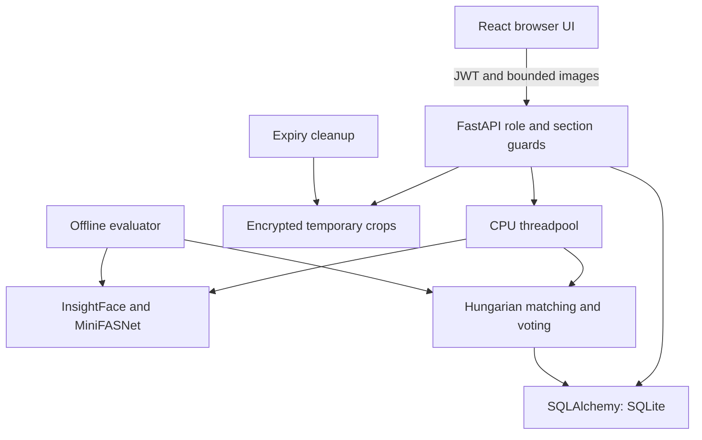
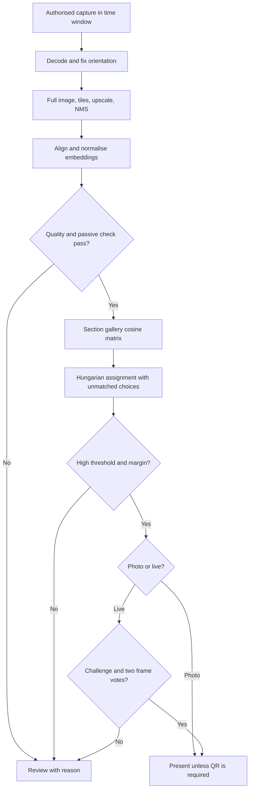
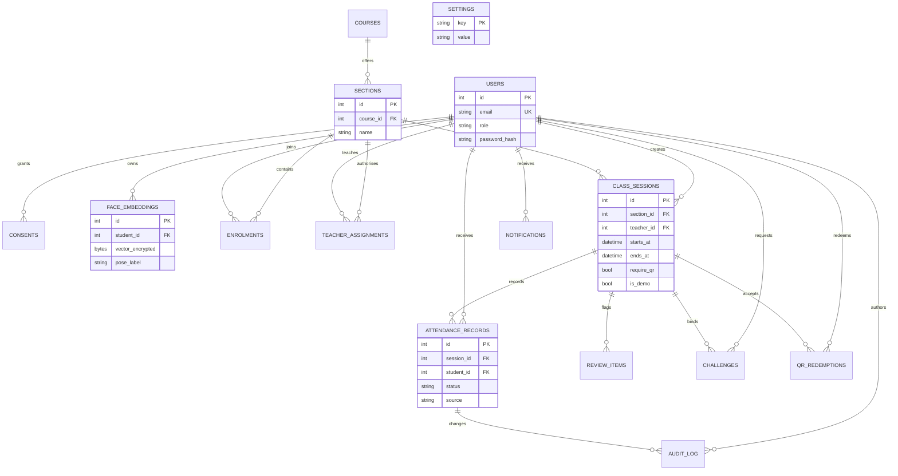
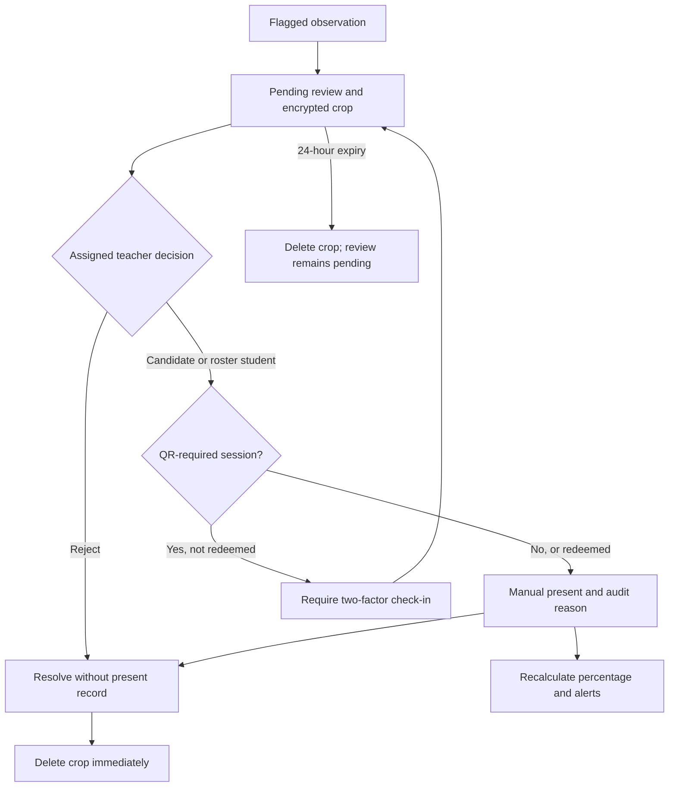

# PUB AttendEye diagrams

## System architecture

## Recognition pipeline

## Entity relationships

The database also enforces unique student/session attendance, unique student/session QR redemption, and composite roster/assignment keys. Settings are global and intentionally have no foreign-key relationship.

## Review and correction flow

